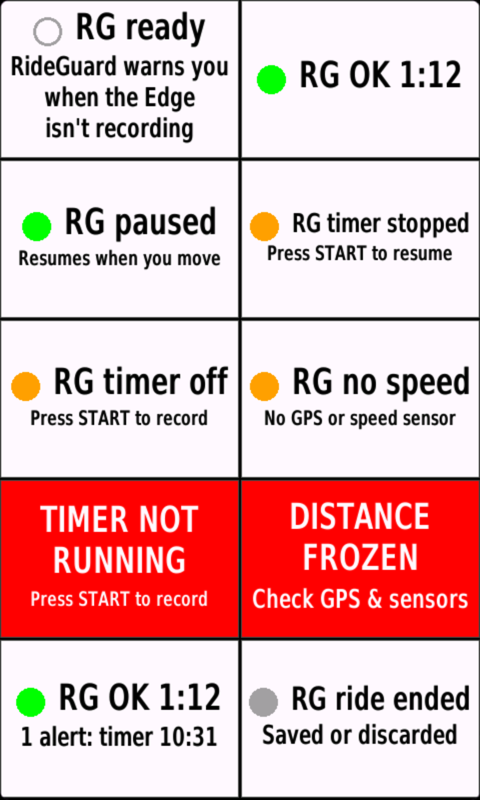
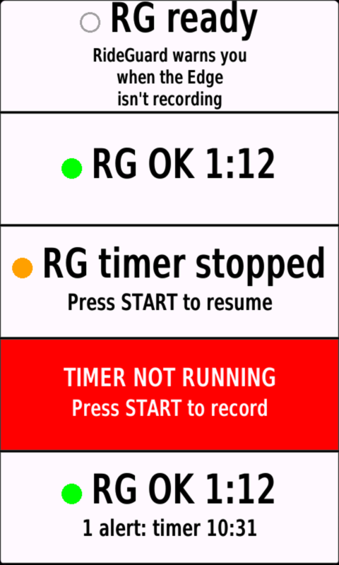

# RideGuard for the Garmin Edge 1050

**A data field that tells you, while you are still riding, that your bike computer has stopped recording.**

 

## Why this exists

On 3 October 2026 my Edge 1050 logged a timer stop two minutes into a three-hour, 65 km ride and
never started again. The screen kept counting distance, so nothing looked wrong. I found out at
home: the saved ride was two minutes long.

Whether that was a stray touch or a fault in the Edge, I can't tell. Either way, nothing warned me.
RideGuard is the warning.

## What it does

RideGuard is a Connect IQ data field. It sits on a data page next to the Edge's own fields and runs
alongside the stock ride software, on every page and in every timer state. Once a second it looks
at the timer, your speed, the ride distance and your sensors.

| It warns when | How |
|---|---|
| You are moving faster than 10 km/h for 30 s and the timer is **not running** (stopped, paused or never started) | Beep, red field, pop-up box. Repeats every 60 s until you press Start |
| The timer is running and you are moving, but the **ride distance has not changed** for 60 s | Beep, red field, pop-up box. Repeats every 60 s |
| **Heart rate or power**, seen earlier in the ride, has been missing for 60 s | Three beeps a minute apart, then silent; the field stays red until the sensor is back |

The rest of the time it shows, in plain words and one colour, what state the recording is in:

- **green** `RG OK 1:12`: recording; `RG paused`: auto-pause at a standstill, which is normal and never an alarm;
- **amber** `RG timer stopped`, `RG timer off`, `RG no speed`: not an alarm yet, with a line saying what to do;
- **red**: one of the three alerts above;
- **grey** `RG ready` before a ride and `RG ride ended` after it.

The full list of states, the install steps and the log format are in
[`RideGuard/README.md`](RideGuard/README.md).

## What it does not do

- It does not keep a copy of the ride. I record every ride on a second device as well (an Epix watch).
- It does not fix or change the Edge. It only watches and warns.
- It is not in the Connect IQ store. It is sideloaded over USB.

## Status (November 2026)

- Built, reviewed and installed on my own Edge 1050 (firmware 32.20).
- All tests pass in the Connect IQ simulator. **It has not yet completed a real ride on the device**, so treat it as untested hardware-side.
- Made for one device and one rider. Other Edge models would need at least a new device entry in the manifest and a look at the field sizes.

## How it works

```
 Edge 1050
┌─────────────────────────────────────────────────┐
│ Stock ride app ── Activity.Info, once a second ─┐│
│                                                 ▼│
│  RideGuard data field                            │
│   Lifecycle   ready → watching → ride ended      │
│   Watchdog    the three alert rules              │
│   Alerter     tone + red field + pop-up box      │
│   StateStore  a small saved record (survives     │
│               the Edge reloading the field)      │
│   EventLog    plain-text log, readable over USB  │
└─────────────────────────────────────────────────┘
```

`Lifecycle` and `Watchdog` are plain logic with no device calls, so every rule is unit-tested. The
display code measures text and picks fonts to fit, because an Edge 1050 field can be anything from
239×158 to 480×800 pixels.

## How it is tested

- **68 unit tests** run in the Connect IQ simulator: every alert rule and threshold, the ride
  lifecycle including reloads, the layout at four field sizes, and the field end to end.
- **41 Python tests** cover the Mac-side tools.
- **Replays of real rides.** On my machine the suite also replays my own rides second by second,
  305 tests in all. The lost ride must raise the timer alert (it does, about two minutes after the
  stop: I stood still first, and the alert comes 30 s after riding on). A normal ride and eight
  later rides must stay silent. The ride recordings are personal and are not in this repository; in
  a fresh clone those tests are skipped.

## What I learned about Connect IQ on the Edge 1050

Measured on firmware 32.20 with a throwaway test field. These may save someone else a weekend.

- A data field's `compute()` runs about once a second, **also while its page is not showing and in every timer state** (off, stopped, paused, running).
- `currentSpeed` stays live with the timer off, stopped and paused. In my logs it was `null` only before a GPS fix.
- `Application.Storage` is **encrypted on the device** and can't be read over USB. The simulator stores it in plain text.
- `System.println` goes to `/Garmin/Apps/LOGS/<NAME>.TXT`, in plain text, **only if that file already exists**. It rotates at about 64 KB into `<NAME>.BAK`.
- `DataField.showAlert` pop-ups are shown while the timer runs and while auto-paused, and are **silently suppressed before Start**. `showAlert` doesn't throw when suppressed.
- `Attention.playTone` works from a data field in every timer state.
- Auto-pause arrives as timer state "paused". After a save or discard the timer returns to "off"; `onTimerReset` was not seen on a discard.
- The Edge reloads data fields often around the data-screen editor, so anything that matters has to be saved and restored.
- A sideloaded `.PRG` copied to `/Garmin/Apps/` is moved to `/Garmin/Apps/Media/` on unplug and stored encrypted there.
- A sideloaded app's settings can't be changed from the Garmin Connect app.
- The SDK's default source path is **every `.mc` file under the project**, tests included. Set `base.sourcePath` in `monkey.jungle`.
- The simulator is not the device: it shows every alert, encrypts nothing and enforces no storage limit.

## What is in this repository

| Path | What it is |
|---|---|
| `RideGuard/source/` | The data field (Monkey C) |
| `RideGuard/test/` | Unit tests and the replay driver |
| `RideGuard/gallery/` | A simulator-only preview that draws every state at real field sizes |
| `RideGuard/doc/` | Screenshots of that preview |
| `RideGuard/README.md` | States, alerts, install, log, settings, troubleshooting |
| `tools/` | Build and test scripts, a small USB (MTP) helper for the Edge, and the replay-test generator |
| `index.html` | A one-page description of the project |

## Build it yourself

You need macOS, the [Connect IQ SDK](https://developer.garmin.com/connect-iq/sdk/) with the
`edge1050` device installed, Homebrew, and your own Connect IQ developer key. Nothing secret is in
this repository; the signing key stays on your machine.

```bash
# Java for the Connect IQ compiler, libmtp for talking to the Edge
brew install openjdk@17 libmtp

# Your own signing key (kept outside the repository)
mkdir -p ~/.garmin-dev
openssl genrsa -out ~/.garmin-dev/developer_key.pem 4096
openssl pkcs8 -topk8 -inform PEM -outform DER -in ~/.garmin-dev/developer_key.pem -out ~/.garmin-dev/developer_key.der -nocrypt
chmod 600 ~/.garmin-dev/developer_key.pem ~/.garmin-dev/developer_key.der

# Python tools
python3 -m venv tools/.venv && tools/.venv/bin/pip install -q -r tools/requirements-dev.txt

# Test, then build
cd tools && .venv/bin/pytest -q && cd ..
RideGuard/test/run.sh
tools/ciq-build.sh RideGuard RideGuard/bin/RIDEGRD.prg
```

Installing on an Edge is described in [`RideGuard/README.md`](RideGuard/README.md). `tools/edge.py`
only opens an Edge 1050 (USB `091e:5158`) and only writes files named `RIDEGRD*` or `RGSPIKE*`.

## Planned

**GarminGuard**, a Mac companion that copies the Edge's rides to an archive every time it is plugged
in and flags a ride whose timer was stopped long before it was saved. Not built yet.

## Reading, not contributing

This is a personal project, published so others can read it. Issues are switched off and pull
requests are not monitored.

No open-source licence has been chosen, so the usual copyright rules apply: you are welcome to read
the code, but it is not licensed for reuse.

## Disclaimer

Not affiliated with or endorsed by Garmin. Garmin, Edge, Epix and Connect IQ are trademarks of
Garmin Ltd. or its subsidiaries. Provided as is, with no warranty: it is a second pair of eyes, not
a guarantee that a ride is recorded.
