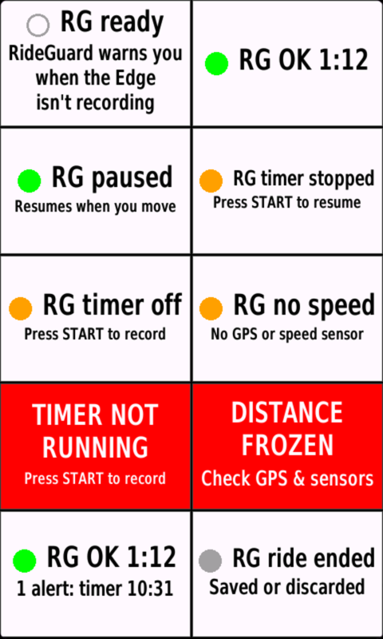
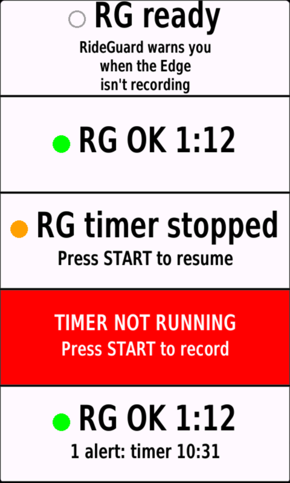

# RideGuard

A Connect IQ data field for the Garmin Edge 1050 that warns you **during the ride** when the Edge
isn't recording properly, and makes the ride's start and end obvious on screen. It runs alongside
the Edge's own ride software, on any data page, in every timer state.

It does not keep a copy of the ride: **record every ride on a second device as well**. I use an
Epix watch, which records its own ride and broadcasts heart rate to the Edge at the same time.

## What you see

 

| Field shows | Meaning | What to do |
|---|---|---|
| ○ `RG ready` (hollow grey dot) | No ride yet. Help pages rotate underneath | Nothing |
| ● `RG OK 1:12` (green) | Recording. The time is the Edge's own timer | Nothing |
| ● `RG paused` (green) | Auto-pause at a standstill: normal, **never an alarm** | Nothing; it resumes when you move |
| ● `RG timer stopped` (amber) | You stopped the timer and the ride is still open | Press START when you ride on |
| ● `RG timer off` (amber) | You're moving but never pressed Start | Press START to record |
| ● `RG no speed` (amber) | No speed for 10 s (no GPS fix, no sensor): RideGuard can't watch | Wait for GPS |
| `TIMER NOT RUNNING` (red field) | Faster than 10 km/h for 30 s and the timer isn't running | **Press START** |
| `DISTANCE FROZEN` (red field) | Timer on and moving, but the ride distance hasn't changed for 60 s | Check GPS and sensors |
| `HR LOST` / `POWER LOST` (red field) | A sensor seen earlier in this ride has been missing for 60 s | Check the strap, watch or meter |
| ● `RG ride ended` (grey) | Saved or discarded. Shown for 60 s | Nothing |
| ● `RG error` (amber) | RideGuard hit a fault and is not watching | Read the log (below); it has the reason |

After an alert, the second line keeps a record for the rest of the ride, e.g. `1 alert: timer 10:31`.

**Alerts** beep (at most once every 10 s) and turn the field red until the problem is gone.

- **Timer not running** and **distance frozen** repeat every 60 s for as long as they last, because
  the ride isn't being recorded.
- **HR lost** and **power lost** beep three times, a minute apart, and then stay silent. The field
  stays red until the sensor is back. They never beep while the timer is paused or stopped, and a
  pause doesn't start the three beeps again.

Each beep also asks the Edge to pop up a red box over whatever page you're on:

- with the timer **running** (distance frozen, sensor lost): the box appears;
- with the timer **auto-paused**: the box appears (seen on real rides);
- with the timer **stopped**: not confirmed. Count on the beep and the red field.

## Where to put it

The Edge has no status-bar icon for apps. Add RideGuard as a field on your **main data page**:
Settings → Activity Profiles → your profile → Data Screens → pick the page → pick a field → Connect IQ → RideGuard.

- One field is enough. It keeps watching while you look at other pages, and beeps sound on any page.
- Any field size works. A full-width field is easier to read than a half-width one.
- The pop-up box needs Connect IQ alerts to be allowed for the profile. If you never see a red box,
  look under Activity Profiles → your profile → Alerts for a Connect IQ entry.

## Install and update (Mac, Edge plugged in)

**Install or update the field:**

```bash
tools/ciq-build.sh RideGuard RideGuard/bin/RIDEGRD.prg
tools/.venv/bin/python tools/edge.py put RideGuard/bin/RIDEGRD.prg /Garmin/Apps RIDEGRD.PRG
```

**First install only: create the empty log file.** Don't repeat this on an update; it would replace
the log on the Edge with an empty one.

```bash
: > RideGuard/bin/RIDEGRD.TXT && tools/.venv/bin/python tools/edge.py put RideGuard/bin/RIDEGRD.TXT /Garmin/Apps/LOGS RIDEGRD.TXT
```

**Read the log** (do this before reinstalling after a problem):

```bash
tools/.venv/bin/python tools/edge.py get /Garmin/Apps/LOGS/RIDEGRD.TXT RideGuard/bin/RIDEGRD.pulled.txt
```

Unplug the Edge; it installs the field. `tools/edge.py` only ever opens the Edge 1050 (USB
`091e:5158`) and only writes files named `RIDEGRD*` or `RGSPIKE*` (the name of an earlier on-device test
build). If an upload fails it says whether RideGuard is still on the Edge.

## The log

The empty `RIDEGRD.TXT` turns on RideGuard's event log. It is plain text, readable from the Mac:

```
08:00:05 INIT mem=17k/124k      field loaded (memory used / limit)
08:01:10 START 2026-05-01       a ride opened
08:20:02 R3.1+                  alert raised (R3.1 timer, R3.2 distance, R3.3hr, R3.3pw)
08:20:20 R3.1-                  alert cleared
09:15:40 END alerts=1 tones=1 boxes=1   the ride was saved or discarded
```

`tones` and `boxes` count the beeps played and pop-up boxes requested during the ride. A `TONE-ERR`
or `BOX-ERR` line means the Edge refused one.

The Edge rotates it at about 64 KB into `RIDEGRD.BAK`. RideGuard works without the log.

## Settings

Defaults: moving above 10 km/h; timer-not-running alert after 30 s; distance frozen after 60 s;
sensor lost after 60 s; repeat every 60 s; beep on; help pages on.

A **sideloaded** app doesn't appear in the Garmin Connect app, so its settings can't be changed
there. To change a default, edit `RideGuard/resources/settings/properties.xml` and reinstall. A
value outside the allowed range (for example a speed of 0) is ignored and the default is used.

If your auto-pause speed is set above 10 km/h, raise the moving speed above it too, or the
timer-not-running alert will fire while you're auto-paused.

## Troubleshooting

- **No beep:** alerts use the Edge's own tones. Check that tones are switched on in the Edge's
  sound settings.
- **Field says "missing" on the Edge:** reinstall (above), unplug, and re-add it to the data page.
- **No log on the Mac:** `RIDEGRD.TXT` must exist in `/Garmin/Apps/LOGS/` before the ride (third install command).
- **It beeps while I ride on purpose without recording** (or with the Edge switched on in a car):
  that is the alert doing its job. Press START, or turn the Edge off.
- **A dead HR strap or power meter:** it beeps three times and then only keeps the field red. To
  switch sensor alerts off altogether, set `r33On` to `false` in `properties.xml` and reinstall.

## Development

- **Setup:** the toolchain and signing key are described in the [top-level README](../README.md).
- **Tests:** `RideGuard/test/run.sh` runs every unit test in the simulator. It first regenerates
  replay tests from local ride recordings (the ride that was lost, a normal ride, and logs of eight
  later rides). Those recordings are personal and not in this repository, so in a fresh clone the
  replay tests are skipped. Python tools: `cd tools && .venv/bin/pytest -q`.
- **Preview every state:** build `RideGuard/gallery.jungle` (the command is in that file) and run it
  with `monkeydo RideGuard/bin/GALLERY.prg edge1050`. It is simulator-only.
- **Layout:** `source/` is the app, `test/` the tests, `gallery/` the preview. `monkey.jungle`
  compiles `source/` only, so no test code or ride data ends up in the installed app.
